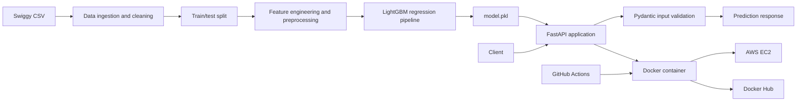

# Swiggy Delivery Time Prediction

An end-to-end machine learning project that predicts food delivery time in minutes from rider, order, route, traffic, weather, vehicle, and timing information. The trained preprocessing and LightGBM regression pipeline is served through FastAPI, packaged with Docker, and deployed on AWS EC2.

[](https://www.python.org/)
[](https://fastapi.tiangolo.com/)
[](https://scikit-learn.org/)
[](https://lightgbm.readthedocs.io/)
[](https://www.docker.com/)
[](https://dvc.org/)

## Table of Contents

- [Live API Demo and Swagger Documentation](#live-api-demo-and-swagger-documentation)
- [Project Overview and Objectives](#project-overview-and-objectives)
- [Key Features](#key-features)
- [System Architecture](#system-architecture)
- [Technology Stack](#technology-stack)
- [Repository Structure](#repository-structure)
- [Dataset and Features](#dataset-and-features)
- [Machine Learning Workflow](#machine-learning-workflow)
- [Model Details and Evaluation](#model-details-and-evaluation)
- [Installation and Local Setup](#installation-and-local-setup)
- [Environment Setup and Dependencies](#environment-setup-and-dependencies)
- [Run the FastAPI Application Locally](#run-the-fastapi-application-locally)
- [API Documentation and Endpoints](#api-documentation-and-endpoints)
- [Sample Prediction](#sample-prediction)
- [Docker](#docker)
- [Docker Hub and Deployment](#docker-hub-and-deployment)
- [AWS EC2 Deployment](#aws-ec2-deployment)
- [GitHub Actions CI/CD](#github-actions-cicd)
- [Testing](#testing)
- [Limitations and Future Improvements](#limitations-and-future-improvements)
- [Learning Outcomes](#learning-outcomes)
- [Author and Contact](#author-and-contact)

## Live API Demo and Swagger Documentation

- **Swagger UI:** [http://54.252.139.246:8000/docs](http://54.252.139.246:8000/docs)
- **Docker Hub image:** [pratik1017/swiggy-delivery-api](https://hub.docker.com/r/pratik1017/swiggy-delivery-api)

The API is deployed on an AWS EC2 instance using Docker. The live URL currently uses **HTTP, not HTTPS**. Availability may change; this repository does not claim a permanent uptime guarantee, custom domain, or SSL certificate.

## Project Overview and Objectives

The project turns the Swiggy delivery dataset into a deployable prediction service. Its objectives are to:

1. Clean and standardize delivery records.
2. Derive operational features such as pickup duration, time of day, weekend status, haversine distance, and distance category.
3. Build a reproducible preprocessing and regression pipeline.
4. Expose predictions through a validated REST API.
5. Package the service as a Docker image suitable for deployment on AWS EC2.

The target is `time_taken`, expressed in minutes.

## Key Features

- FastAPI application with automatic OpenAPI/Swagger documentation.
- Pydantic validation for numeric ranges and categorical values.
- Saved inference pipeline in [`model.pkl`](./model.pkl), including preprocessing and the LightGBM regressor.
- DVC pipeline for ingestion, splitting, feature engineering, and final model generation.
- Numeric scaling, one-hot encoding, and ordered categorical encoding.
- Docker image based on Python 3.12 slim with the system library required by LightGBM.
- GitHub Actions workflow that builds and publishes versioned and `latest` images to Docker Hub on pushes to `main`.
- Optional MLflow/DagsHub experiment logging in the training scripts.

## System Architecture



At inference time, the API loads `model.pkl`, converts the validated request into a one-row pandas DataFrame, calls the saved pipeline, and returns the predicted time rounded to two decimal places.

## Technology Stack

| Area | Technologies |
| --- | --- |
| Language and API | Python, FastAPI, Uvicorn, Pydantic |
| Data processing | pandas, NumPy |
| ML and preprocessing | scikit-learn, LightGBM, joblib, pickle |
| Experiment tracking | MLflow and DagsHub integrations in training scripts |
| Reproducibility | DVC, `dvc.yaml`, `dvc.lock`, `params.yaml` |
| Packaging and serving | Docker, Docker Hub, Uvicorn |
| CI/CD | GitHub Actions |
| Documentation | Sphinx source files and FastAPI OpenAPI docs |

## Repository Structure

```text
.
├── api/
│   ├── Dockerfile
│   ├── main.py
│   └── schemas.py
├── data/
│   ├── external/swiggy.csv
│   ├── raw/swiggy_cleaned.csv
│   ├── interim/{train.csv,test.csv}
│   └── processed/{train_trans.csv,test_trans.csv}
├── docs/
│   ├── index.rst
│   ├── getting-started.rst
│   ├── commands.rst
│   └── Makefile
├── models/
│   └── preprocessor.pkl
├── notebooks/
├── reports/
├── src/
│   ├── data/data_ingestion.py
│   ├── data/data_preprocessing.py
│   ├── features/feature_engineering.py
│   └── models/
│       ├── baseline_model.py
│       ├── final_model.py
│       └── optuna_tuning.py
├── .github/workflows/ci-cd.yaml
├── dvc.yaml
├── dvc.lock
├── model.pkl
├── params.yaml
├── requirements-api.txt
└── requirements.txt
```

The repository also contains placeholder files for notebooks, reports, visualization, and model directories. The local `myenv/` virtual environment is not part of the tracked project structure.

## Dataset and Features

The source file is [`data/external/swiggy.csv`](./data/external/swiggy.csv). The ingestion script normalizes column names, removes the source `id`, cleans numeric and categorical values, parses dates and times, derives features, and writes [`data/raw/swiggy_cleaned.csv`](./data/raw/swiggy_cleaned.csv).

The API accepts the following 15 model features:

| Feature | Type and validation | Description |
| --- | --- | --- |
| `rider_age` | float, 18–70 | Delivery rider age |
| `rider_ratings` | float, 0–5 | Rider rating |
| `weather` | categorical: `fog`, `sandstorms`, `stormy`, `sunny`, `windy` | Delivery weather |
| `traffic` | categorical: `low`, `medium`, `high`, `jam` | Route traffic |
| `vehicle_condition` | integer, 0–3 | Vehicle condition rating |
| `type_of_order` | categorical: `drinks`, `meal`, `snack`, `buffet` | Order category |
| `type_of_vehicle` | categorical: `motorcycle`, `scooter`, `electric_scooter`, `bicycle` | Delivery vehicle |
| `multiple_deliveries` | integer, 0–3 | Number of concurrent deliveries |
| `festival` | categorical: `yes`, `no` | Whether a festival is occurring |
| `city_type` | categorical: `semi-urban`, `urban`, `metropolitian` | City classification |
| `is_weekend` | integer, 0 or 1 | Weekend indicator |
| `pickup_time_minutes` | float, non-negative | Time from order to pickup |
| `order_time_of_day` | categorical: `afternoon`, `evening`, `morning`, `night` | Order time bucket accepted by the API |
| `distance_km` | float, non-negative | Haversine restaurant-to-customer distance |
| `distance_type` | categorical: `short`, `medium`, `long`, `very_long` | Distance bucket |

During ingestion, distance categories use cut points of 0–5 km (`short`), 5–10 km (`medium`), 10–15 km (`long`), and 15 km or more (`very_long`). The training transformation also retains `vehicle_condition` and `multiple_deliveries` as passthrough features.

## Machine Learning Workflow

The DVC stages in [`dvc.yaml`](./dvc.yaml) are:

1. **Data ingestion:** clean source columns and derive date, time, distance, and categorical features.
2. **Data preprocessing:** split the cleaned data into training and test sets using `test_size: 0.25` and `random_state: 42` from [`params.yaml`](./params.yaml).
3. **Feature engineering:** drop missing rows and fit a `ColumnTransformer`:
   - `MinMaxScaler` for `rider_age`, `rider_ratings`, `pickup_time_minutes`, and `distance_km`.
   - `OneHotEncoder` for nominal categorical features, with first-category dropping and unknown-category handling.
   - `OrdinalEncoder` for ordered `traffic` and `distance_type`, with unknown values encoded as `-1`.
4. **Model training:** train a `Pipeline` containing the preprocessor and `LGBMRegressor`, then save it as `model.pkl`.
5. **Experiment logging:** the final-model script attempts to log parameters, metrics, the model artifact, and the serialized pipeline to MLflow through DagsHub. Local model saving is retained if remote logging fails.

To reproduce the DVC pipeline after installing the project dependencies:

```bash
dvc repro
```

## Model Details and Evaluation

The final model is a scikit-learn `Pipeline` with the saved transformer and `LGBMRegressor`. The configured LightGBM model uses 197 estimators, learning rate `0.03545159182046778`, 70 leaves, maximum depth 17, and `random_state=42`, along with the other parameters defined in [`src/models/final_model.py`](./src/models/final_model.py).

The training script calculates test **MAE**, **RMSE**, and **R²** and logs them when MLflow is available. Numeric evaluation results are not reproduced here because no verified output report or recorded metric values is included in the repository.

## Installation and Local Setup

Clone the repository and create a clean virtual environment:

```bash
git clone https://github.com/Pratik1017/swiggy_delivery_time_prediction.git
cd swiggy_delivery_time_prediction

python -m venv .venv
```

Activate it on Windows:

```powershell
.venv\Scripts\Activate.ps1
```

On macOS/Linux:

```bash
source .venv/bin/activate
```

## Environment Setup and Dependencies

For API inference, install the dependencies declared in [`requirements-api.txt`](./requirements-api.txt):

```bash
python -m pip install --upgrade pip
python -m pip install -r requirements-api.txt
```

For training and the complete experiment workflow, install [`requirements.txt`](./requirements.txt). Do not commit credentials for DagsHub, MLflow, Docker Hub, or AWS; configure those through the relevant local or CI secret mechanisms.

## Run the FastAPI Application Locally

From the repository root, with the environment activated and `model.pkl` present:

```bash
uvicorn api.main:app --reload --host 0.0.0.0 --port 8000
```

Open [http://localhost:8000/docs](http://localhost:8000/docs) for Swagger UI or [http://localhost:8000/redoc](http://localhost:8000/redoc) for ReDoc.

## API Documentation and Endpoints

### `GET /`

Returns an API health/status payload:

```json
{
  "project": "Swiggy Delivery Time Prediction",
  "status": "API is running successfully",
  "docs": "/docs",
  "prediction_endpoint": "/predict"
}
```

```bash
curl http://localhost:8000/
```

### `POST /predict`

Validates a delivery record and returns the predicted delivery time in minutes. All 15 input fields listed in [Dataset and Features](#dataset-and-features) are required. Invalid ranges or unsupported literal values result in FastAPI/Pydantic validation errors.

```bash
curl -X POST "http://localhost:8000/predict" ^
  -H "Content-Type: application/json" ^
  -d "{\"rider_age\":30,\"rider_ratings\":4.7,\"weather\":\"sunny\",\"traffic\":\"medium\",\"vehicle_condition\":2,\"type_of_order\":\"meal\",\"type_of_vehicle\":\"motorcycle\",\"multiple_deliveries\":1,\"festival\":\"no\",\"city_type\":\"urban\",\"is_weekend\":0,\"pickup_time_minutes\":12.5,\"order_time_of_day\":\"evening\",\"distance_km\":6.2,\"distance_type\":\"medium\"}"
```

The verified response shape is:

```json
{
  "predicted_time_taken": 28.47
}
```

The number above illustrates the response shape; the actual value is produced by the loaded model and depends on the request. The same request in a Bash shell can be written as:

```bash
curl -X POST "http://localhost:8000/predict" \
  -H "Content-Type: application/json" \
  -d '{
    "rider_age": 30,
    "rider_ratings": 4.7,
    "weather": "sunny",
    "traffic": "medium",
    "vehicle_condition": 2,
    "type_of_order": "meal",
    "type_of_vehicle": "motorcycle",
    "multiple_deliveries": 1,
    "festival": "no",
    "city_type": "urban",
    "is_weekend": 0,
    "pickup_time_minutes": 12.5,
    "order_time_of_day": "evening",
    "distance_km": 6.2,
    "distance_type": "medium"
  }'
```

## Docker

The Dockerfile is [`api/Dockerfile`](./api/Dockerfile). It installs the API dependencies, installs `libgomp1` for LightGBM, copies `api/` and `model.pkl`, exposes port 8000, and starts Uvicorn.

Build and run locally from the repository root:

```bash
docker build -f api/Dockerfile -t swiggy-delivery-api:latest .
docker run --rm -p 8000:8000 swiggy-delivery-api:latest
```

Then visit [http://localhost:8000/docs](http://localhost:8000/docs).

## Docker Hub and Deployment

Pull the published image:

```bash
docker pull pratik1017/swiggy-delivery-api:latest
```

Run it as a background service:

```bash
docker run -d \
  --name swiggy-api \
  --restart unless-stopped \
  -p 8000:8000 \
  pratik1017/swiggy-delivery-api:latest
```

For remote access, the AWS security group must allow inbound TCP traffic to the configured API port (8000 in the commands above). Restrict administrative access to the required trusted sources rather than opening SSH unnecessarily to the entire internet.

## AWS EC2 Deployment

The repository supports the following deployment flow, consistent with the Dockerized API:

1. Launch an EC2 instance with a Docker-compatible Linux distribution.
2. Install and start Docker on the instance.
3. Configure the security group to allow API traffic on TCP port 8000 from the clients that need it. Keep management access restricted to trusted sources.
4. Pull and run the image using the commands in [Docker Hub and Deployment](#docker-hub-and-deployment).
5. Verify the service at `http://<EC2_PUBLIC_IP>:8000/` and open `/docs` for Swagger UI.

The currently provided deployment URL is [http://54.252.139.246:8000/docs](http://54.252.139.246:8000/docs). It is HTTP-only and should not be treated as a permanent production endpoint.

## GitHub Actions CI/CD

[`ci-cd.yaml`](./.github/workflows/ci-cd.yaml) runs on pushes and pull requests targeting `main`, and can also be started manually. Its Docker build-and-push job is skipped for pull requests and:

1. Checks out the repository.
2. Configures Docker Buildx.
3. Logs in to Docker Hub using the GitHub secrets `DOCKERHUB_USERNAME` and `DOCKERHUB_TOKEN`.
4. Builds from the repository root using `api/Dockerfile`.
5. Pushes both `latest` and the commit-SHA image tags.

The workflow publishes to the Docker Hub namespace supplied by the configured secret; the documented image is `pratik1017/swiggy-delivery-api`.

## Testing

No dedicated automated test suite is tracked in the repository. A practical smoke test after starting the service is:

```bash
curl http://localhost:8000/
curl -X POST "http://localhost:8000/predict" ^
  -H "Content-Type: application/json" ^
  -d "{\"rider_age\":30,\"rider_ratings\":4.7,\"weather\":\"sunny\",\"traffic\":\"medium\",\"vehicle_condition\":2,\"type_of_order\":\"meal\",\"type_of_vehicle\":\"motorcycle\",\"multiple_deliveries\":1,\"festival\":\"no\",\"city_type\":\"urban\",\"is_weekend\":0,\"pickup_time_minutes\":12.5,\"order_time_of_day\":\"evening\",\"distance_km\":6.2,\"distance_type\":\"medium\"}"
```

## Limitations and Future Improvements

- The live service is exposed over HTTP rather than HTTPS.
- No automated API, data-quality, or model-regression tests are currently tracked.
- The repository does not document a model registry, rollback strategy, monitoring, alerting, or scheduled retraining process.
- The API loads a pickle artifact at process startup; artifact compatibility and provenance should be managed explicitly for long-lived production use.
- Add an HTTPS reverse proxy and custom domain before production use.
- Add request, latency, error-rate, and prediction-drift monitoring.
- Add CI validation for schema behavior, Docker startup, and representative predictions.
- Record and publish reproducible evaluation reports and dataset/version metadata.
- Add model/version health checks and a controlled deployment or rollback strategy.

## Learning Outcomes

This project demonstrates practical experience with:

- Turning raw operational data into model-ready features.
- Building reusable scikit-learn preprocessing and modeling pipelines.
- Using DVC to describe reproducible data and model stages.
- Comparing and tuning regression models with cross-validation, Optuna, and MLflow integrations.
- Serving a trained model through a typed FastAPI contract.
- Creating a small Docker image for inference.
- Publishing an image through GitHub Actions and deploying it to an AWS EC2 host.

## Author and Contact

**Pratik Deshmukh**

- GitHub: [Pratik1017](https://github.com/Pratik1017)
- Email: `deshmukhpratik0000@gmail.com`

The contact details above are based on the repository's existing Git configuration. Update them if a different public contact channel is preferred.
